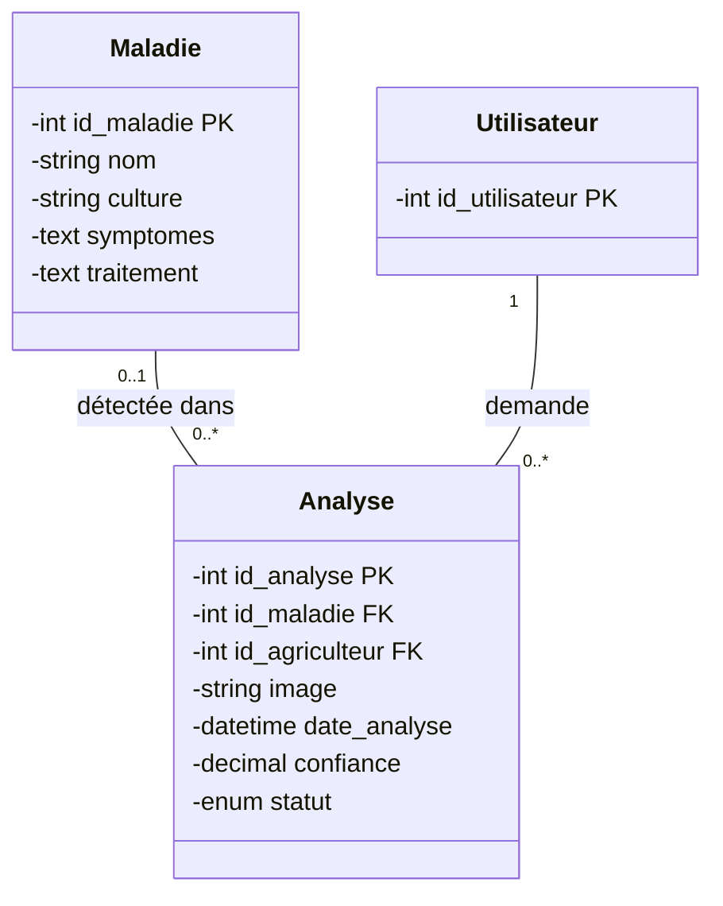

# Module 3 – Diagnostic IA

> Projet **AgriNoVa** – Projet Technologies Web 2A – **Esprit School of Engineering** (2026–2027)

**Responsable :** [Étudiant 3](https://github.com/utilisateur3)
**Branche Git :** `module3-diagnostic`

## Table des matières
- [Objectif](#objectif)
- [Entités et relation](#entités-et-relation)
- [Fonctionnement du diagnostic](#fonctionnement-du-diagnostic)
- [Requêtes SQL principales](#requêtes-sql-principales)
- [Fonctionnalités](#fonctionnalités)
- [Routes du module](#routes-du-module)
- [Contrôles de saisie](#contrôles-de-saisie)
- [Sécurité et rôles](#sécurité-et-rôles)
- [Fichiers du module](#fichiers-du-module)
- [Scénarios de test](#scénarios-de-test)
- [Captures d’écran](#captures-décran)

## Objectif

Aider l’agriculteur à **détecter tôt une maladie** à partir de la photo d’une feuille, et lui proposer un traitement adapté.
Une détection précoce limite les pertes de récolte et l’usage excessif de produits phytosanitaires.
Ce module contribue à l’**ODD 2** (faim zéro) et à l’**ODD 12** (production responsable).

> ⚠️ Le résultat est **indicatif** : il ne remplace pas l’avis d’un agronome.

## Entités et relation

| Entité | Attribut | Type | Description |
|---|---|---|---|
| **Maladie** | `id_maladie` | INT, PK | Identifiant |
| | `nom` | VARCHAR(120) | Nom de la maladie (ex : Œil de paon, Mildiou) |
| | `culture` | VARCHAR(80) | Culture concernée (olivier, tomate, blé…) |
| | `symptomes` | TEXT | Description des symptômes visibles |
| | `traitement` | TEXT | Traitement conseillé |
| **Analyse** | `id_analyse` | INT, PK | Identifiant |
| | `id_maladie` | INT, FK → maladie, **NULL possible** | Maladie détectée (vide si la plante est saine) |
| | `id_agriculteur` | INT, FK → utilisateur | Agriculteur qui a envoyé la photo |
| | `image` | VARCHAR(255) | Chemin de la photo envoyée |
| | `date_analyse` | DATETIME | Date de l’analyse |
| | `confiance` | DECIMAL(5,2) | Taux de confiance de 0 à 100 % |
| | `statut` | ENUM | `en_attente`, `terminee` |

**Relation :** une maladie peut être détectée dans plusieurs analyses → **Maladie 0..1 — 0..\* Analyse** (clé étrangère `id_maladie`).
`0..1` car une analyse peut ne détecter **aucune** maladie. Si une maladie est supprimée, `id_maladie` passe à `NULL` (`ON DELETE SET NULL`) et l’historique est conservé.



## Fonctionnement du diagnostic

1. L’agriculteur choisit la **culture** et envoie la **photo** d’une feuille.
2. La photo est enregistrée dans `uploads/analyses/` avec un nom unique ; une ligne `Analyse` est créée avec le statut `en_attente`.
3. Le **service d’analyse** renvoie la maladie probable et un taux de confiance :
   - **Prototype** : analyse simulée à partir de la culture choisie et de la liste des maladies (suffisant pour la validation) ;
   - **Évolution** : appel à un modèle pré-entraîné de reconnaissance des maladies des plantes (API externe ou modèle local).
4. L’analyse passe au statut `terminee` ; la page résultat affiche la maladie, les symptômes, le traitement et la confiance.
5. Si la confiance est inférieure à 60 %, un message conseille de consulter un agronome ou de **contacter le support** (module 5).

## Requêtes SQL principales

**Jointure – historique des analyses d’un agriculteur**
```sql
SELECT a.date_analyse, a.image, a.confiance, m.nom AS maladie, m.traitement
FROM analyse a
LEFT JOIN maladie m ON a.id_maladie = m.id_maladie
WHERE a.id_agriculteur = :id
ORDER BY a.date_analyse DESC;
```
`LEFT JOIN` permet d’afficher aussi les analyses sans maladie détectée (plante saine).

**Jointure – maladies possibles pour une culture (utilisée par l’analyse simulée)**
```sql
SELECT id_maladie, nom, symptomes, traitement
FROM maladie
WHERE culture = :culture;
```

**Statistiques Back Office – maladies les plus détectées**
```sql
SELECT m.nom, m.culture, COUNT(a.id_analyse) AS nb_detections,
       ROUND(AVG(a.confiance), 1) AS confiance_moyenne
FROM maladie m
LEFT JOIN analyse a ON a.id_maladie = m.id_maladie
GROUP BY m.id_maladie
ORDER BY nb_detections DESC;
```

## Fonctionnalités

### Front Office
| Fonctionnalité | Rôle |
|---|---|
| Formulaire d’analyse : choix de la culture + envoi de la photo | agriculteur |
| Page résultat : maladie probable, confiance, symptômes, traitement | agriculteur |
| Historique « Mes analyses » avec filtre par culture et par date | agriculteur |
| Suppression d’une de ses analyses | agriculteur |
| Lien « Contacter le support » si le résultat est incertain (module 5) | agriculteur |
| Fiches des maladies consultables (encyclopédie) | agriculteur, vendeur |

### Back Office
| Fonctionnalité | Rôle |
|---|---|
| CRUD complet des maladies (nom, culture, symptômes, traitement) | admin |
| Consultation de toutes les analyses, filtre par culture et par maladie | admin |
| Correction manuelle d’un résultat (choix de la bonne maladie) | admin |
| Statistiques : maladies les plus détectées, analyses par mois, confiance moyenne | admin |

## Routes du module

| Action (`index.php?action=...`) | Méthode | Rôle | Description |
|---|---|---|---|
| `diagnostic` | GET / POST | agriculteur | Envoi de la photo |
| `analyse_resultat&id=` | GET | agriculteur | Résultat d’une analyse |
| `mes_analyses` | GET | agriculteur | Historique |
| `analyse_delete` | POST | agriculteur | Supprimer une de ses analyses |
| `maladies` / `maladie_detail&id=` | GET | agriculteur, vendeur | Fiches des maladies |
| `admin_maladies` | GET | admin | Liste des maladies |
| `admin_maladie_create` / `admin_maladie_edit&id=` | GET / POST | admin | Ajout / modification |
| `admin_maladie_delete` | POST | admin | Suppression |
| `admin_analyses` | GET | admin | Toutes les analyses + statistiques |
| `admin_analyse_corriger` | POST | admin | Correction d’un résultat |

## Contrôles de saisie

Chaque champ est vérifié **en JavaScript** (`data-rules`, fichier `assets/js/validation.js`) **et en PHP** (contrôleur).

| Champ | Règle JavaScript | Contrôle PHP |
|---|---|---|
| Culture | `required` | valeur dans la liste des cultures existantes |
| Photo | `required` + vérification du type et de la taille avant l’envoi | `$_FILES` sans erreur, type réel JPG ou PNG (`finfo`), 5 Mo maximum, `getimagesize()` valide |
| Nom de la maladie | `required\|minlen:3\|maxlen:120` | longueur entre 3 et 120, nom unique pour une même culture |
| Symptômes / traitement | `required\|minlen:10` | 10 caractères minimum |

**Sécurité de l’envoi de fichiers**
- Le type est vérifié à partir du **contenu réel** du fichier (`finfo_file`), pas de l’extension envoyée.
- Le fichier est renommé avec un nom aléatoire (`bin2hex(random_bytes(16)) . '.jpg'`) : le nom d’origine n’est jamais utilisé.
- Le dossier `uploads/` n’exécute pas de PHP (fichier `.htaccess` : `php_flag engine off`).

## Sécurité et rôles

- `AuthController::requireRole(...)` en première ligne de chaque action (voir tableau des routes).
- Jeton CSRF (`csrf_token`) dans tous les formulaires POST, vérifié avec `AuthController::verifyCsrfToken()`.
- Requêtes préparées PDO uniquement ; affichage avec `e()` (`htmlspecialchars`).
- Un agriculteur ne peut voir et supprimer **que ses propres analyses** : la requête filtre toujours sur `id_agriculteur = AuthController::currentUserId()`.

## Fichiers du module

```
models/MaladieModel.php              # attributs privés + getters/setters + fromArray()
models/AnalyseModel.php
controllers/MaladieController.php    # CRUD maladies, statistiques
controllers/AnalyseController.php    # envoi de la photo, analyse, historique, correction
views/diagnostic.php                 # Front Office : formulaire d’analyse
views/analyse_resultat.php
views/mes_analyses.php
views/maladies.php
views/admin_maladies.php             # Back Office
views/admin_maladie_form.php
views/admin_analyses.php
uploads/analyses/                    # photos envoyées (ignorées par Git)
```

## Scénarios de test

| # | Scénario | Résultat attendu |
|---|---|---|
| 1 | Agriculteur `karim@agrinova.tn` envoie la photo d’une feuille d’olivier | Résultat affiché avec maladie, confiance et traitement |
| 2 | Envoi d’un fichier `.pdf` ou d’un `.php` renommé en `.jpg` | Refusé : « Format d’image non valide » |
| 3 | Envoi d’une image de plus de 5 Mo | Refusé |
| 4 | Formulaire envoyé sans photo | Erreur JavaScript, puis PHP si le JS est désactivé |
| 5 | Karim modifie l’`id` dans l’URL pour voir l’analyse d’un autre agriculteur | Accès refusé |
| 6 | Agriculteur tape `index.php?action=admin_maladies` | Page 403 |
| 7 | Admin supprime une maladie déjà détectée | Les analyses restent dans l’historique (maladie vide) |

## Captures d’écran

| Résultat du diagnostic (Front Office) | Gestion des maladies (Back Office) |
|---|---|
|  |  |
