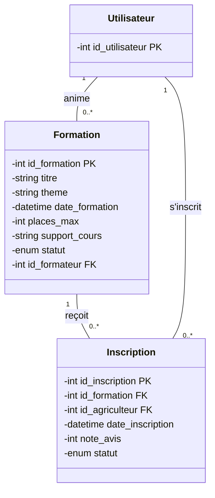

# Module 6 – Formations agricoles

> Projet **AgriNoVa** – Projet Technologies Web 2A – **Esprit School of Engineering** (2026–2027)

**Responsable :** [Mahdi FakhFakh](https://github.com/MahdiFakh2006)
**Branche Git :** `module6-formations`

## Table des matières
- [Objectif](#objectif)
- [Entités et relation](#entités-et-relation)
- [Requêtes SQL principales](#requêtes-sql-principales)
- [Fonctionnalités](#fonctionnalités)
- [Routes du module](#routes-du-module)
- [Contrôles de saisie](#contrôles-de-saisie)
- [Sécurité et rôles](#sécurité-et-rôles)
- [Fichiers du module](#fichiers-du-module)
- [Scénarios de test](#scénarios-de-test)
- [Captures d’écran](#captures-décran)

## Objectif

Permettre aux agriculteurs d’apprendre à utiliser le matériel intelligent (capteurs, drones, IA) et à mieux gérer l’eau,
grâce à des formations proposées par les vendeurs (formateurs) et validées par l’administrateur.
Ce module contribue à l’**ODD 6** (eau propre) et à l’**ODD 9** (innovation accessible).

## Entités et relation

| Entité | Attribut | Type | Description |
|---|---|---|---|
| **Formation** | `id_formation` | INT, PK | Identifiant |
| | `titre` | VARCHAR(150) | Titre de la formation |
| | `theme` | VARCHAR(80) | Irrigation, drones, IA, agriculture biologique… |
| | `date_formation` | DATETIME | Date et heure de la séance |
| | `places_max` | INT | Nombre de places (1 à 200) |
| | `support_cours` | VARCHAR(255) | Fichier PDF du support (facultatif) |
| | `statut` | ENUM | `en_attente`, `validee`, `annulee` |
| | `id_formateur` | INT, FK → utilisateur | Vendeur qui anime la formation |
| **Inscription** | `id_inscription` | INT, PK | Identifiant |
| | `id_formation` | INT, FK → formation | Formation concernée |
| | `id_agriculteur` | INT, FK → utilisateur | Agriculteur inscrit |
| | `date_inscription` | DATETIME | Date de l’inscription |
| | `note_avis` | TINYINT | Avis de 1 à 5 (après la formation) |
| | `statut` | ENUM | `inscrit`, `present`, `absent`, `annule` |

**Relation :** une formation reçoit plusieurs inscriptions → **Formation 1 — 0..\* Inscription** (clé étrangère `id_formation`).
Contrainte `UNIQUE (id_formation, id_agriculteur)` : un agriculteur ne peut pas s’inscrire deux fois à la même formation.



## Requêtes SQL principales

**Jointure – places restantes des formations validées à venir**
```sql
SELECT f.titre, f.theme, f.date_formation,
       f.places_max - COUNT(i.id_inscription) AS places_restantes
FROM formation f
LEFT JOIN inscription i
       ON i.id_formation = f.id_formation AND i.statut <> 'annule'
WHERE f.statut = 'validee' AND f.date_formation >= NOW()
GROUP BY f.id_formation
ORDER BY f.date_formation;
```

**Jointure – « Mes formations » d’un agriculteur**
```sql
SELECT f.titre, f.date_formation, f.support_cours, i.statut, i.note_avis
FROM inscription i
JOIN formation f ON i.id_formation = f.id_formation
WHERE i.id_agriculteur = :id
ORDER BY f.date_formation DESC;
```

**Statistiques Back Office – taux de remplissage et note moyenne**
```sql
SELECT f.titre,
       ROUND(COUNT(i.id_inscription) * 100 / f.places_max) AS taux_remplissage,
       ROUND(AVG(i.note_avis), 1) AS note_moyenne
FROM formation f
LEFT JOIN inscription i ON i.id_formation = f.id_formation AND i.statut <> 'annule'
GROUP BY f.id_formation;
```

## Fonctionnalités

### Front Office
| Fonctionnalité | Rôle |
|---|---|
| Calendrier des formations validées, filtre par thème et recherche par titre | agriculteur, vendeur |
| Fiche détaillée : date, formateur, places restantes | agriculteur |
| Inscription en un clic, annulation avant la date | agriculteur |
| « Mes formations » : historique, téléchargement du support, avis de 1 à 5 | agriculteur |
| Proposer une formation (statut `en_attente`) et voir ses inscrits | vendeur |

### Back Office
| Fonctionnalité | Rôle |
|---|---|
| CRUD complet des formations | admin |
| Validation ou annulation des formations proposées | admin |
| Liste des inscrits par formation, marquage présent / absent | admin |
| Statistiques : taux de remplissage, note moyenne, thèmes les plus demandés | admin |

## Routes du module

| Action (`index.php?action=...`) | Méthode | Rôle | Description |
|---|---|---|---|
| `formations` | GET | agriculteur, vendeur | Calendrier des formations |
| `formation_detail&id=` | GET | agriculteur, vendeur | Fiche d’une formation |
| `formation_inscrire` | POST | agriculteur | Inscription |
| `formation_annuler` | POST | agriculteur | Annulation d’une inscription |
| `mes_formations` | GET | agriculteur | Mes inscriptions |
| `formation_avis` | POST | agriculteur | Note de 1 à 5 |
| `formation_proposer` | GET / POST | vendeur | Proposer une formation |
| `admin_formations` | GET | admin | Liste et statistiques |
| `admin_formation_create` / `admin_formation_edit&id=` | GET / POST | admin | Ajout / modification |
| `admin_formation_delete` / `admin_formation_statut` | POST | admin | Suppression / validation |
| `admin_inscrits&id=` | GET / POST | admin | Inscrits et présences |

## Contrôles de saisie

Chaque champ est vérifié **en JavaScript** (`data-rules`, fichier `assets/js/validation.js`) **et en PHP** (contrôleur).

| Champ | Règle JavaScript (`data-rules`) | Contrôle PHP |
|---|---|---|
| Titre | `required\|minlen:3\|maxlen:150` | longueur entre 3 et 150 |
| Thème | `required` | valeur dans la liste autorisée |
| Date | `required\|date\|futuredate` | date valide et future |
| Places | `required\|integer\|min:1\|max:200` | entier entre 1 et 200 |
| Support de cours | — | PDF uniquement, 5 Mo maximum |
| Note d’avis | `required\|integer\|min:1\|max:5` | entier entre 1 et 5, formation déjà passée |

**Règles métier vérifiées côté serveur**
- Inscription refusée si la formation est complète, passée, annulée ou non validée.
- Double inscription impossible (contrainte `UNIQUE` + vérification dans le contrôleur).
- Un vendeur ne voit et ne modifie que ses propres formations.

## Sécurité et rôles

- `AuthController::requireRole(...)` en première ligne de chaque action (voir tableau des routes).
- Jeton CSRF (`csrf_token`) dans tous les formulaires POST, vérifié avec `AuthController::verifyCsrfToken()`.
- Requêtes préparées PDO uniquement ; affichage avec `e()` (`htmlspecialchars`).
- L’identifiant de l’agriculteur vient de la session (`AuthController::currentUserId()`), jamais du formulaire.

## Fichiers du module

```
models/FormationModel.php            # attributs privés + getters/setters + fromArray()
models/InscriptionModel.php
controllers/FormationController.php  # CRUD formations, validation, statistiques
controllers/InscriptionController.php# inscription, annulation, avis, présences
views/formations.php                 # Front Office : calendrier
views/formation_detail.php
views/mes_formations.php
views/formation_form.php             # proposition par le vendeur
views/admin_formations.php           # Back Office : liste + statistiques
views/admin_formation_form.php
views/admin_inscrits.php
```

## Scénarios de test

| # | Scénario | Résultat attendu |
|---|---|---|
| 1 | Agriculteur `karim@agrinova.tn` s’inscrit à une formation validée | Inscription enregistrée, places restantes −1 |
| 2 | Il tente de s’inscrire une 2ᵉ fois | Message « Vous êtes déjà inscrit » |
| 3 | Inscription à une formation complète | Refusée |
| 4 | Vendeur `amel@agrinova.tn` propose une formation avec une date passée | Erreur JavaScript puis PHP |
| 5 | La formation proposée n’apparaît qu’après validation par l’admin | Statut `en_attente` → `validee` |
| 6 | Agriculteur tape `index.php?action=admin_formations` | Page 403 |
| 7 | Formulaire envoyé sans `csrf_token` (F12) | « Jeton de sécurité invalide » |

## Captures d’écran

| Calendrier (Front Office) | Gestion (Back Office) |
|---|---|
|  |  |
